# Evaluación 03 


Evaluación 03 de **Diseño de Interfaces de Programación Avanzado**.
Autor: **Moises Llajaruna Sare** · Repositorio: `evaluacion03-js`

🔗 **GitHub Pages:** https://COMPLETAR-USUARIO.github.io/evaluacion03-js/

## Tabla de contenidos

- [P1 DOM y eventos](#p1-dom-y-eventos)
- [P2 ES6 y módulos](#p2-es6-y-módulos)
- [P3 Fetch y async await](#p3-fetch-y-async-await)
- [P4 Bitácora de IA](#p4-bitácora-de-ia)
- [Checklist de entregables](#checklist-de-entregables)
- [Conclusión](#conclusión)

---

## P1 DOM y eventos

Carpeta: [`p1-dom/`](p1-dom/) · Demo: `.../p1-dom/`

### Tabla de eventos

| Elemento | Evento | Acción |
| --- | --- | --- |
| `#form-pedido` | `submit` | `preventDefault()`, validar, crear el pedido, guardarlo en el arreglo y llamar a `render()` |
| `#filtro` | `change` | Llamar a `render()` para mostrar todos / pendientes / entregados |
| `#lista-pedidos` | `click` (delegación) | Con `closest("button[data-id]")` detectar **Entregar** o **Eliminar**, actualizar el arreglo y llamar a `render()` |

### Pedido como objeto

```js
function crearPedido(producto, precio, cantidad) {
  return {
    id: siguienteId++, producto, precio, cantidad, estado: "pendiente",
    subtotal() { return this.precio * this.cantidad; },
    marcarEntregado() { this.estado = "entregado"; }
  };
}
```

### render() desde el arreglo (seguro)

```js
const texto = document.createElement("span");
texto.textContent = `${p.producto} - S/ ${p.precio.toFixed(2)} x ${p.cantidad}`;
```

### Delegación de eventos (un solo listener)

```js
lista.addEventListener("click", (evento) => {
  const boton = evento.target.closest("button[data-id]");
  if (!boton || !lista.contains(boton)) return;
  const id = Number(boton.dataset.id);
  // entregar o eliminar según boton.dataset.accion
});
```

**Justificación:** los botones se crean y se destruyen cada vez que se llama a `render()`. Con un listener por botón habría que volver a registrarlos en cada dibujo (más código, más memoria y riesgo de olvidar alguno). Con **un solo listener** en `#lista-pedidos` aprovecho que el evento sube (*bubbling*): funciona también para botones creados después, gasta menos memoria y el código queda en un solo lugar.

### Prueba de seguridad (XSS)

Texto probado como producto: ``

| Caso | Qué pasó | Captura |
| --- | --- | --- |
| **Antes** (`innerHTML`) | El navegador interpretó el HTML, la imagen falló y **se ejecutó `alert(1)`** | `img/p1-xss-antes.png` |
| **Después** (`textContent` / `createElement`) | El texto se mostró tal cual, **sin ejecutar nada** | `img/p1-xss-despues.png` |

**Riesgo:** con `innerHTML` cualquier usuario podría inyectar JavaScript (XSS) y robar datos o secuestrar la sesión. **Decisión:** uso `textContent` y `createElement` porque tratan los datos del usuario siempre como texto.

### Capturas

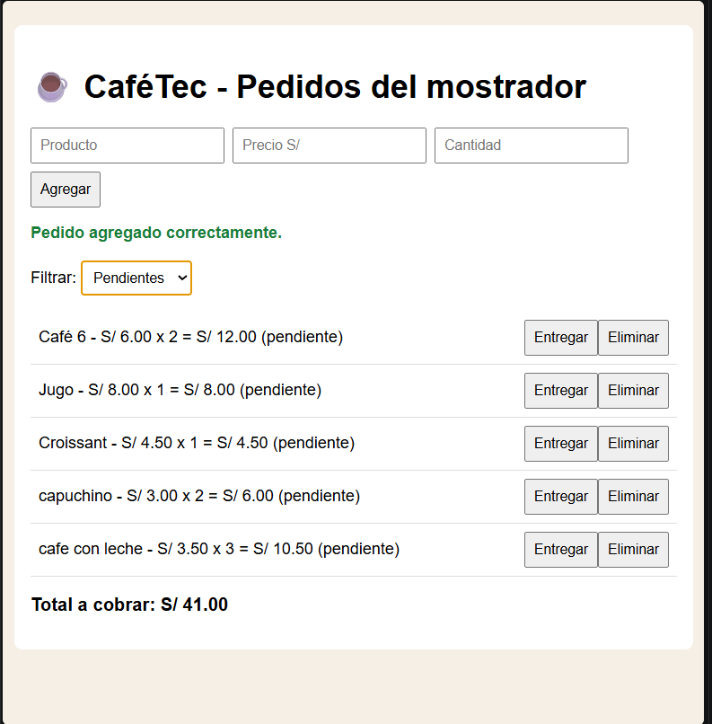
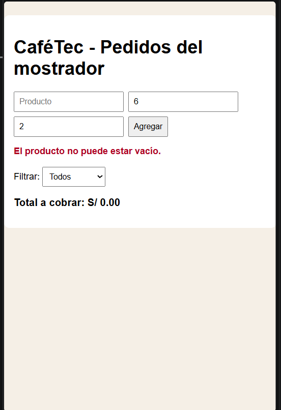
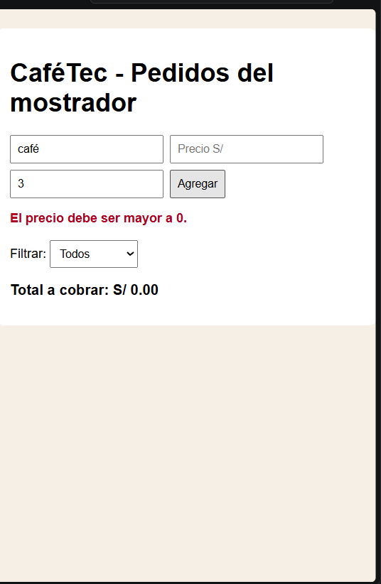
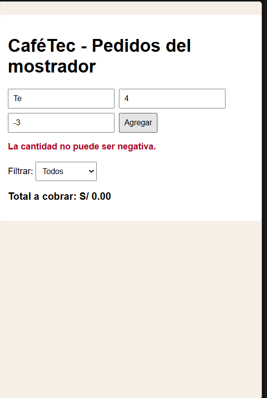

---

## P2 ES6 y módulos

Carpeta: [`p2-modulos/`](p2-modulos/)

### Cálculo manual

| Pedido | Cálculo | Subtotal |
| --- | --- | --- |
| Café | 6 × 2 | 12.00 |
| Croissant (cancelado) | 4.5 × **0** | 0.00 |
| Jugo (sin cantidad) | 8 × 1 | 8.00 |
| **Suma** | | **20.00** |
| IGV 18 % | 20 × 0.18 | 3.60 |
| **Total correcto** | | **S/ 23.60** |

El código antiguo devuelve **28.91**. La diferencia es **5.31 = 4.5 × 1.18**.

**Causa del error:** `pedidos[i].cantidad || 1`. El operador `||` considera falso el `0`, así que el croissant cancelado (0 unidades) pasa a valer 1 y se cobra. El operador `??` solo reemplaza `null` o `undefined`, por eso respeta el `0`. (Además `resumen()` mostraba `xundefined` cuando no había cantidad.)

```js
// Antiguo (con error)
var cantidad = pedidos[i].cantidad || 1;

// Moderno (correcto)
const subtotal = pedidos.reduce((acum, { precio, cantidad }) => acum + precio * (cantidad ?? 1), 0);
```

Resultado con el mismo arreglo: antiguo **28.91** → refactorizado **23.6** ✅ (se ve en la consola de la página y con `node codigo-antiguo.js`).

### Características ES6+

| Característica ES6+ | Dónde la usé | Por qué |
| --- | --- | --- |
| `const` / `let` | Todo el código | Reemplazan a `var`; evitan reasignaciones accidentales |
| Funciones flecha | `calcularTotal`, `resumen`, callbacks | Sintaxis corta |
| Template literals | `resumen()`, `render()` | Evitan concatenar con `+` |
| Desestructuración con valores por defecto | Constructor de `Pedido`, `resumen()` | `cantidad = 1` si no viene |
| `reduce()` | `calcularTotal()` | Suma sin bucle `for` |
| Encadenamiento opcional `?.` | `cliente?.nombre` | No falla si no hay cliente |
| Operador `??` | `cantidad ?? 1` | Respeta el `0` (corrige el error) |
| `class` | `Pedido` | Agrupa datos y métodos |
| Spread `...` | `pedidos = [...pedidos, nuevo]`, `marcarEntregado()` | Actualiza sin mutar el arreglo original |
| Módulos ES | `pedidos.js`, `ui.js`, `main.js` | Código separado por responsabilidad |

### Módulos y tipo de export

- `pedidos.js` → **export default** `Pedido` (es lo principal del archivo) + **export nombrado** `calcularTotal`, `resumen`, `IGV`.
- `ui.js` → solo **exports nombrados** (varias funciones del DOM).
- `main.js` → no exporta nada (es el punto de entrada).

**Justificación:** uso `export default` cuando el archivo tiene *una* cosa principal (la clase), y exports nombrados cuando hay *varias* funciones o constantes, porque obligan a usar el mismo nombre al importar y ayudan al autocompletado.

### Error con `file://`

Al abrir `index.html` con doble clic, la consola muestra un error parecido a:

```text
Access to script at 'file:///.../main.js' from origin 'null' has been blocked by CORS policy
```

**Por qué ocurre:** los módulos ES se descargan con peticiones y el navegador solo las permite por `http://` o `https://`; con `file://` el origen es `null` y bloquea la carga. **Solución:** abrir la carpeta con un servidor local (Live Server de VS Code).

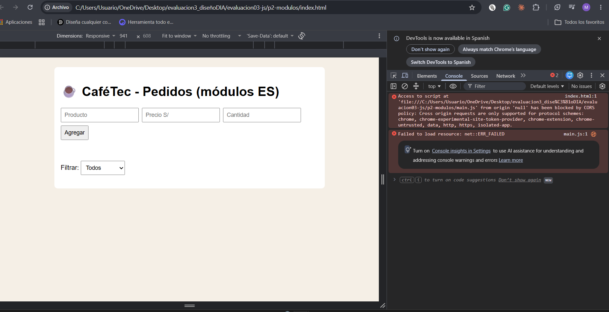

---

## P3 Fetch y async await

Carpeta: [`p3-api/`](p3-api/)

### Tabla de endpoints

| Endpoint | Parámetros que usa | Campos de la respuesta que necesita |
| --- | --- | --- |
| `https://geocoding-api.open-meteo.com/v1/search` | `name`, `count=1`, `language=es` | `results[0].name`, `results[0].admin1`, `results[0].latitude`, `results[0].longitude` |
| `https://api.open-meteo.com/v1/forecast` | `latitude`, `longitude`, `current=temperature_2m,wind_speed_10m` | `current.temperature_2m`, `current.wind_speed_10m`, `current_units` |

### Código clave

```js
async function buscarCiudad(nombre) {
  const response = await fetch(`${URL_GEO}?name=${encodeURIComponent(nombre)}&count=1&language=es`);
  if (!response.ok) throw new Error(`Error ${response.status} al buscar la ciudad.`);
  const datos = await response.json();
  if (!datos.results || datos.results.length === 0) throw new Error(`No se encontró la ciudad "${nombre}".`);
  // ...
}
```

```js
try {
  const datos = await climaDeCiudad(nombre);
  mostrarClima(datos);
} catch (error) {
  mostrarEstado(mensajeAmigable(error), "error");
} finally {
  btnBuscar.disabled = false;
}
```

**¿Por qué `fetch` no lanza error con un 404 o 500?** Porque `fetch` solo rechaza la promesa cuando falla la red (sin conexión, DNS, etc.). Un 404 o 500 es una respuesta HTTP válida que sí llegó; por eso hay que revisar `response.ok` y lanzar el error manualmente.

### Capturas de los estados

| Estado | Captura |
| --- | --- |
| Cargando… | 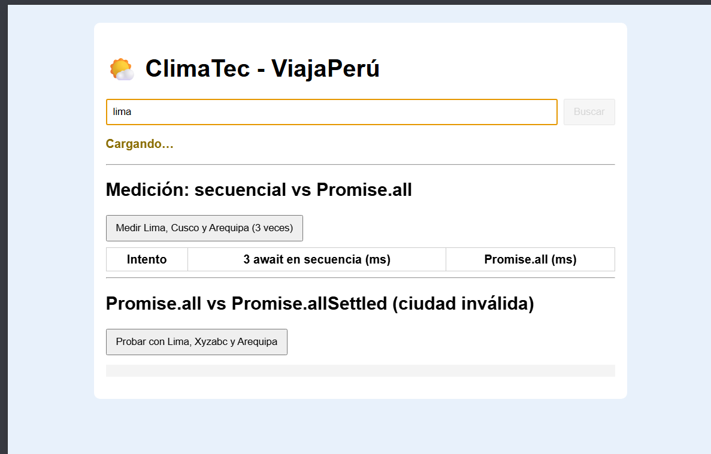 |
| Éxito | 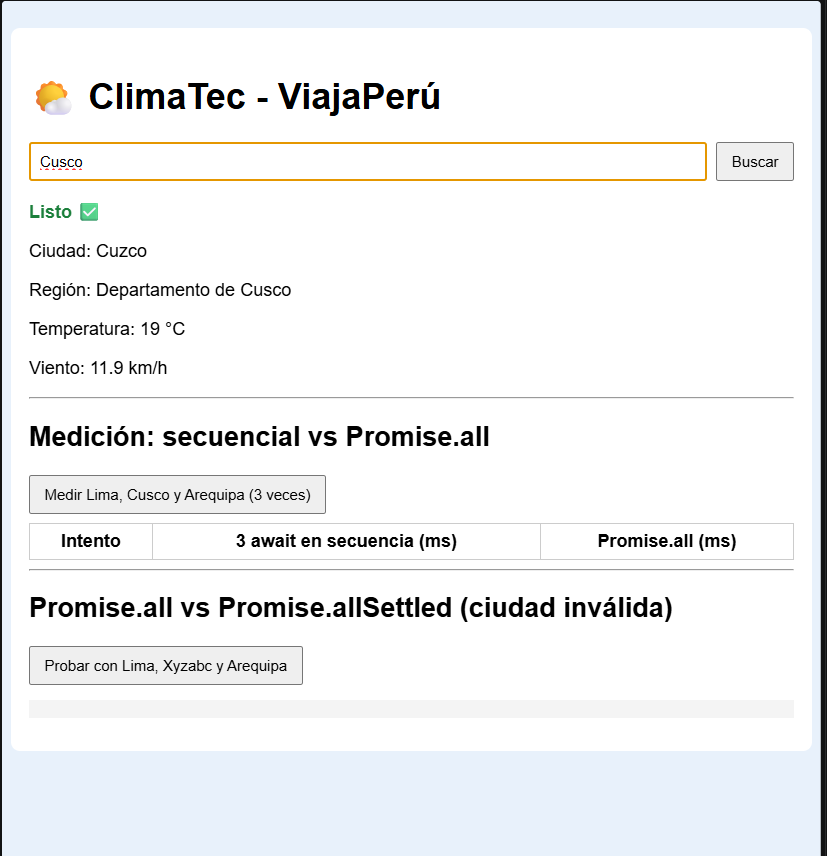 |
| Ciudad no encontrada (Xyzabc) | 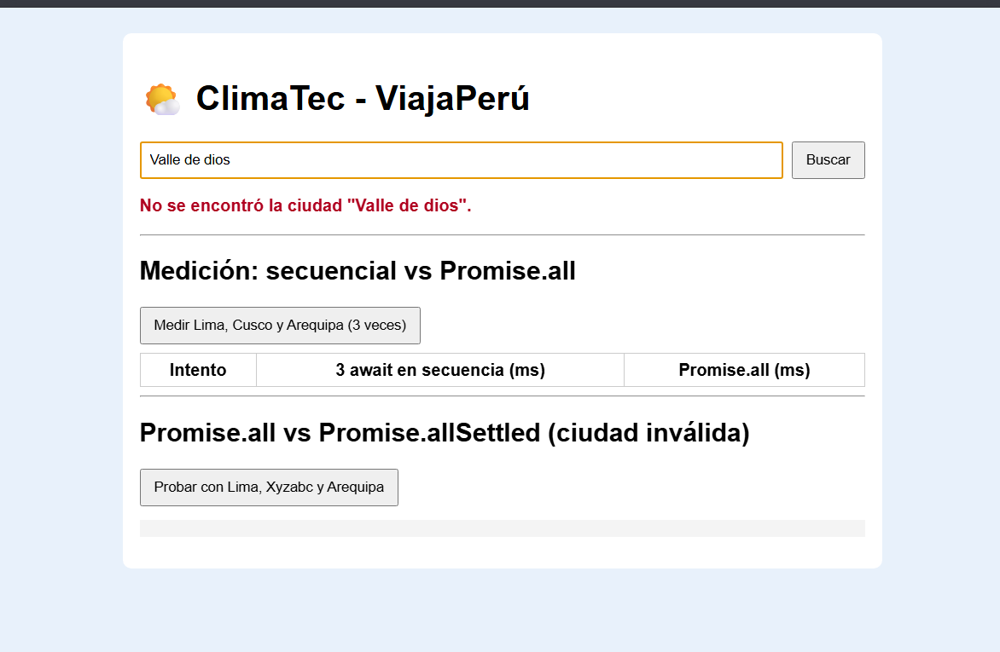 |
| Sin conexión (DevTools → Offline) | 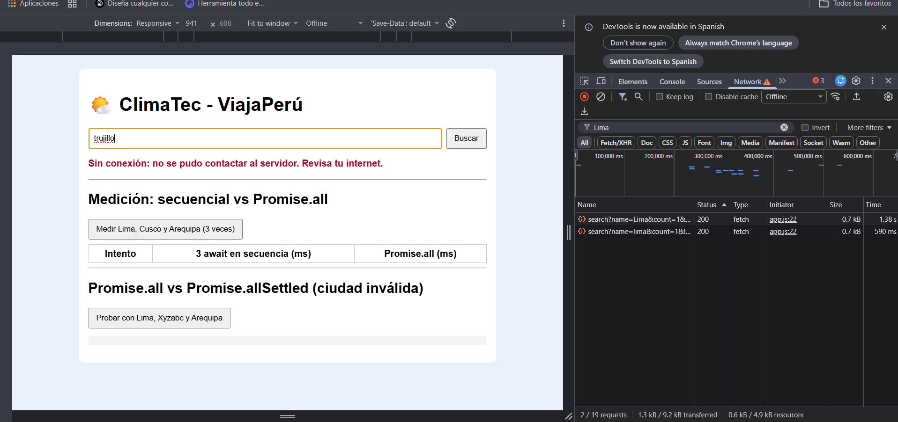 |

### Tiempos: secuencial vs Promise.all

Mediciones propias con `performance.now()` (Lima, Cusco y Arequipa):

| Intento | 3 `await` en secuencia (ms) | `Promise.all` (ms) |
| --- | --- | --- |
| 1 | 1253 | 489 |
| 2 | 1844 | 506|
| 3 | 1247| 417 |
| **Promedio** | 1448 | 471|

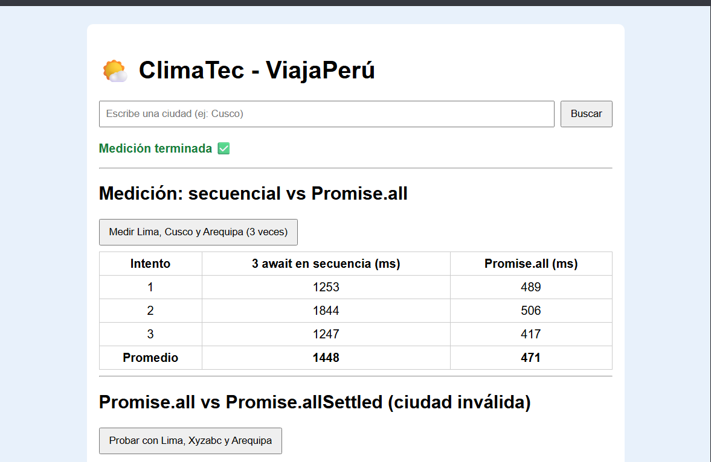

**Conclusión:** `Promise.all` conviene porque las tres ciudades no dependen entre sí, así que las peticiones salen al mismo tiempo y el total es cercano a la más lenta, en vez de la suma de las tres. COMPLETAR con tus números reales (por ejemplo: "en promedio fue X veces más rápido").

### Promise.all vs Promise.allSettled

Con `["Lima", "Xyzabc", "Arequipa"]`:

- `Promise.all` se rechaza apenas una falla y **se pierden** los resultados de Lima y Arequipa.
- `Promise.allSettled` espera a todas y devuelve el estado de cada una (`fulfilled` / `rejected`).

**Decisión:** uso `Promise.allSettled` cuando el usuario pide varias ciudades, porque una ciudad inválida no debe ocultar el clima de las demás. `Promise.all` solo sirve si todo es necesario (todo o nada).

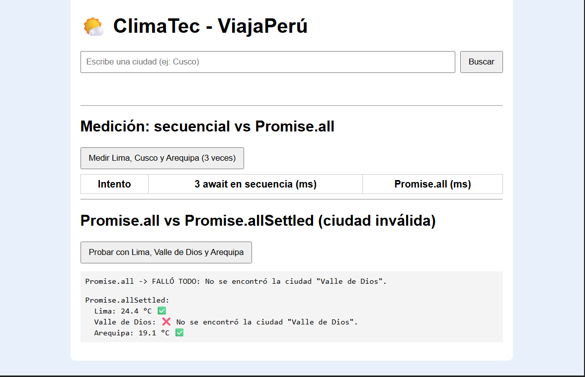

### Diagrama del flujo

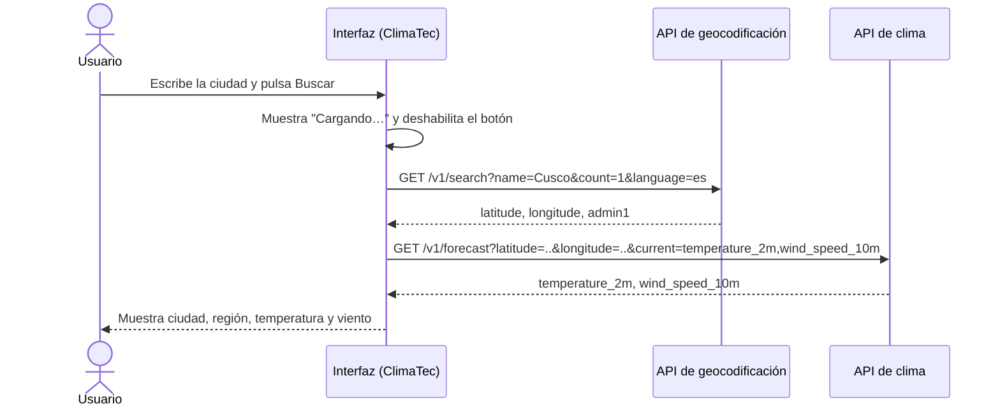

---

## P4 Bitácora de IA

| # | Pregunta | IA usada | ¿Qué propuso la IA? | Decisión | ¿Por qué? |
| - | -------- | -------- | ------------------- | :------: | --------- |
| 1 | P1 | Claude | `render()` con `createElement` y `textContent`, y el total con `reduce()` | Aceptó | Probé con ``: no se ejecutó nada. Agregué 3 pedidos y el total coincidió con mi cálculo a mano |
| 2 | P1 | Claude | Un solo listener en `#lista-pedidos` con `closest("button[data-id]")` | Aceptó | Probé Entregar y Eliminar en pedidos nuevos y después de filtrar; siguen funcionando aunque `render()` recree los botones |
| 3 | P2 | Claude | Cambiar `\|\| 1` por `?? 1` en `calcularTotal` | Aceptó | Ejecuté el código antiguo (28.91) y el nuevo (23.6) con el mismo arreglo y comparé con mi cálculo manual (23.60) |
| 4 | P2 | Claude | `Pedido` como `export default` y las funciones como exports nombrados | Corrigió | Mantuve default solo para la clase y nombrados para `ui.js`, porque tiene varias funciones; verifiqué que los `import` cargan sin errores en Live Server |
| 5 | P3 | Claude | Usar `current=temperature_2m,wind_speed_10m` y leer `current.temperature_2m` | Aceptó | Comparé cada parámetro y campo con la documentación en open-meteo.com y probé la respuesta en la consola del navegador |
| 6 | P3 | Claude | Validar `results` antes de leer `results[0]` y usar `Promise.allSettled` | Aceptó | Probé "Xyzabc": la API no devuelve `results` y sin esa validación habría un error; con `allSettled` Lima y Arequipa se muestran aunque una falle |

---

## Checklist de entregables

- [x] P1: tabla de eventos
- [x] P1: código funcional en `p1-dom/`
- [ ] P1: capturas y evidencia de la prueba de seguridad (antes y después)
- [x] P1: justificación de la delegación de eventos
- [x] P2: cálculo manual y código antiguo/refactorizado en `p2-modulos/`
- [x] P2: tabla de características ES6+ y justificación del export
- [ ] P2: captura del error con `file://`
- [x] P3: tabla de endpoints y código en `p3-api/`
- [ ] P3: capturas de estados (cargando, éxito, no encontrada, sin conexión)
- [ ] P3: tabla de tiempos con capturas
- [x] P3: justificación de `Promise.all` vs `allSettled`
- [x] P4: README con badges, tabla de contenidos, diagrama Mermaid y bitácora
- [ ] P4: 6 commits progresivos y GitHub Pages publicado

---

## Conclusión

En esta evaluación usé la IA como apoyo, pero las decisiones técnicas las tomé yo después de probar. Decidí usar **delegación de eventos** con un solo listener en la lista, porque los botones se vuelven a crear en cada `render()`. Decidí dibujar con **`textContent` y `createElement`** en vez de `innerHTML`, porque con el texto `` comprobé que `innerHTML` ejecuta código (XSS) y `textContent` no. También elegí **`??` en lugar de `||`**: el error del código antiguo cobraba un croissant cancelado, porque `0 || 1` da 1, y lo verifiqué calculando a mano 23.60 contra el 28.91 que devolvía el código viejo. En la P3 elegí **`Promise.allSettled`** cuando una ciudad puede fallar, y `Promise.all` para medir la velocidad, porque mis mediciones mostraron que las llamadas en paralelo tardan menos que tres `await` seguidos. Entre los errores que detecté: que `fetch` no lanza error con un 404 o 500 (hay que revisar `response.ok`) y que la geocodificación no devuelve `results` si la ciudad no existe. Los módulos ES no funcionan con `file://` por la política CORS y se arreglan con Live Server. La IA me ayudó mucho a escribir código repetitivo, estructurar el README y proponer ideas, pero no me sirvió para dar por correcto algo sin probarlo: cada parámetro, cálculo y resultado lo tuve que verificar con la consola, la documentación oficial y mis propias capturas.
